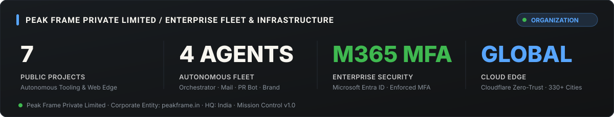

# Vijay Sirohi
### Founder & Lead Architect · [Peak Frame Private Limited](https://github.com/Peak-Frame-Private-Limited)

Building autonomous multi-agent systems, intelligent distributed platforms, and high-performance digital infrastructure.

---

## ⚡ Founder Progress & Engineering Architecture

  

---

## 🏢 Peak Frame Organization & Fleet Infrastructure

  

---

## 🛠️ Core Technology Stack

- **Languages:** Python, TypeScript, JavaScript, SQL
- **Frameworks & Runtimes:** FastAPI, Next.js, Node.js, Uvicorn
- **Cloud & Edge:** Cloudflare Workers, Cloudflare Zero-Trust Tunnels, Microsoft Graph API, Microsoft Entra ID
- **AI & Automation:** Multi-Agent Systems, Anthropic API, Graph Orchestration, Baileys WebSocket Bridges

---

  Vijay Sirohi · Peak Frame Private Limited · https://peakframe.in

